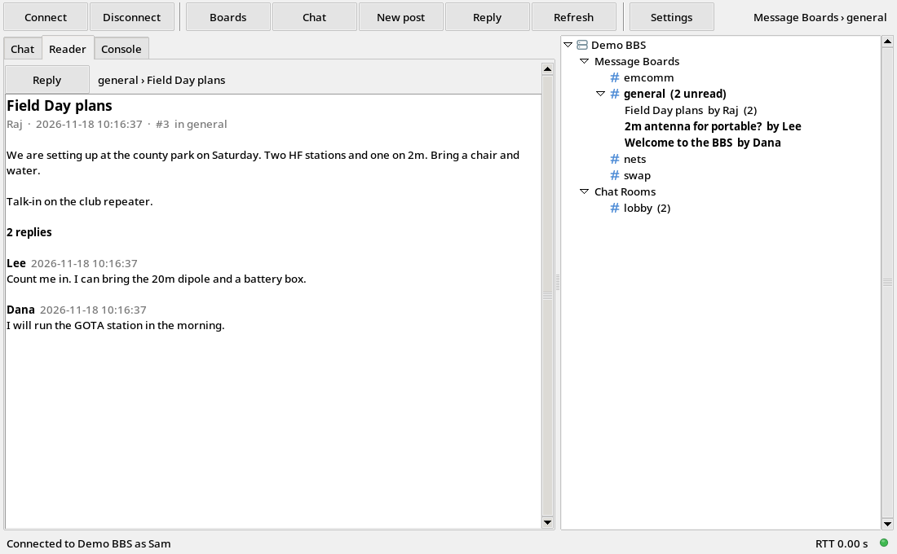

# retibbs_client

A desktop client for [RetiBBS](https://github.com/kc1awv/RetiBBS), the bulletin board system for Reticulum networks.
It uses the look and layout of [partyline](https://github.com/RFnexus/partyline): a server tree on the right, chat
and reading on the left, light and dark themes.

RetiBBS ships with a terminal (Textual) client where you type menu commands. This client turns the boards, messages
and chat rooms into a clickable tree, opens messages in a reader, and gives you post and reply dialogs. A Console
tab still shows everything the server sends and takes raw commands.

Reading a message (light theme):



Chatting in a room (dark theme):


## How it works

RetiBBS servers reply with text meant for people plus a few control packets (`CTRL AREA`, `CTRL BOARD`,
`CTRL ROOM`). The client recognises the replies it needs (board list, message list, a message, room list, chat
lines) by their wording and shows anything else in the Console tab. It also moves between the server's areas for
you: opening a board sends `b`, `cb <board>`, `lm`; joining a room sends `/b`, `c`, `/j <room>`.

Limits that come from the server:

- Leaving the chat area leaves your chat room. Opening the boards while in a room asks first.
- A post or reply must fit in one Reticulum packet. The limit depends on the link; the post dialog shows it.
- The server cannot answer "who am I" until you have a display name. Set one in Settings.

## Compatibility

- Python 3.10 or newer, Linux, macOS or Windows
- Tested against the RetiBBS server at commit `7c26d2c` (January 2026)
- Uses the same identity file as the RetiBBS Textual client, so you keep your account and admin rights

## Requirements

- [Reticulum](https://reticulum.network/) (`rns`) with a working configuration
- [Rich](https://github.com/Textualize/rich) for colors in server menus
- Tk for Python, which pip cannot install. On Debian or Ubuntu: `sudo apt install python3-tk`. On Fedora:
  `sudo dnf install python3-tkinter`

## Reticulum

The client does not need its own rnsd service. When it starts, it looks for a shared Reticulum instance:

- If one is running (`rnsd`, or another app with sharing on, such as MeshChat, Sideband or NomadNet), the client
  attaches to it and uses its interfaces.
- If none is running, the client starts Reticulum itself from `~/.reticulum/config`, or the folder given with
  `--reticulum-config`. While the client is open, other Reticulum apps attach to it.

If the client started Reticulum, closing it takes the network down for every app attached to it. If you run several
Reticulum apps, or want the machine always reachable, run `rnsd` as a service and let the apps attach to it.

## Install

```bash
git clone https://github.com/mleo40/retibbs_client.git
cd retibbs_client
python3 -m venv .venv
.venv/bin/pip install .
```

## Usage

Start the client:

```bash
.venv/bin/retibbs-gui
```

Connect straight to a server:

```bash
.venv/bin/retibbs-gui --server b40428672a09c6c100ca82c10e5d945f
```

Use another Reticulum configuration:

```bash
.venv/bin/retibbs-gui --reticulum-config ~/.reticulum-test
```

In the window:

- Server > Connect opens Favourites and Discovered servers (from announces). Double click one to connect.
- Double click a board to list its messages. Unread messages are bold. Double click a message to read it.
- Toolbar New post and Reply open dialogs. Right click a board to watch it for LXMF alerts.
- Double click a chat room to join it. Right click Chat Rooms to create one. Type in the Chat tab to talk.
- Commands typed in the Chat tab that start with `/` go to the server's chat area (`/list`, `/leave`).
- The Console tab shows the server's own menus and takes any RetiBBS command, for example `?` or `wl`.
- Admins also get New board and Delete board on right click.

Settings and saved servers live in `~/.config/retibbs-gui/`.

## Tests

```bash
.venv/bin/python -m unittest discover -s tests -t .
```

## Credits

- Theme, palettes and layout adapted from partyline (public domain)
- Icons from [Tabler Icons](https://tabler.io/icons) (MIT), see `retibbs_gui/icons/LICENSE`

## Revision history

- 0.1.0: First prototype
