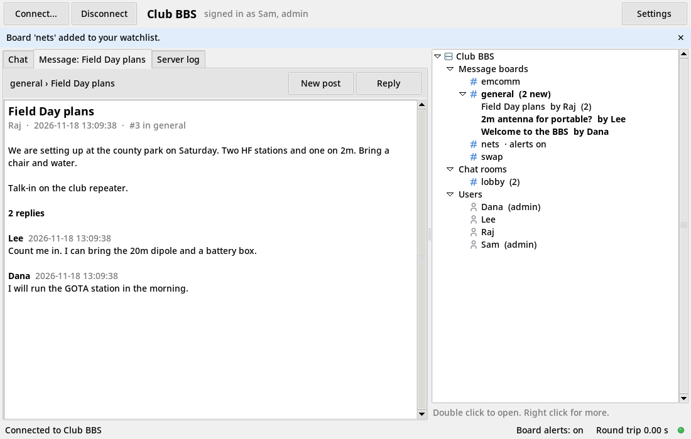
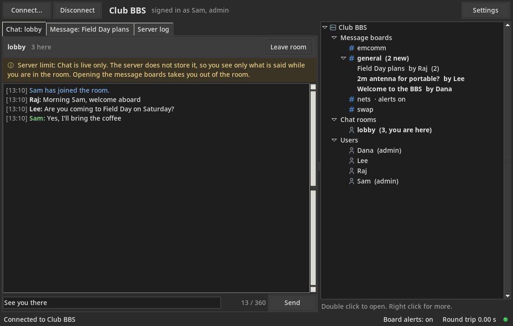

# retibbs_client

A desktop client for [RetiBBS](https://github.com/kc1awv/RetiBBS), the bulletin board system for Reticulum networks.
It uses the look and layout of [partyline](https://github.com/RFnexus/partyline), with light and dark themes.

RetiBBS ships with a terminal (Textual) client where you type menu commands. This client turns the boards, messages,
chat rooms and users into a clickable list, opens messages in a reader, gives you post and reply dialogs, and shows
the server's limits where they apply.

Reading a message (light theme):



Chatting in a room, as an admin with the user list loaded (dark theme):



Writing a post that is too long for one packet, with the limit of a LoRa link:


Settings, with the address for board alerts:


## Layout

- Toolbar: the connection only. Connect, Disconnect, the BBS name and who you are signed in as, and Settings.
- Right: everything on the BBS. Message boards and their messages, chat rooms, and Users for admins. Double click
  to open, right click for more.
- Left: three tabs, each with its own buttons in its header.
  - Chat: the room you are in, with Leave room and a counter for the message size.
  - Message: the post you opened, with Reply and New post.
  - Server log: everything the server sends. Type any RetiBBS command here.
- A strip under the toolbar shows the server's answers: errors in red, confirmations in blue.
- Status bar: connection, board alerts on or off, and round trip time.

## Features

- Boards with new message counts, paging, and a reader for messages and their replies
- New post and reply dialogs that count bytes against the packet limit of your connection
- Chat rooms: join, leave, start one, with a size counter on every message
- Board alerts: set your LXMF address in Settings, send a test, and turn alerts on per board
- Admins: list users, make admins, create and delete boards
- Your own name for each BBS, kept when the server announces a different one
- Asks for a display name on first connect, since RetiBBS needs one before it answers

## Server limits

These come from the RetiBBS server, not from this client. The client marks them with a yellow Server limit note where
they apply, and lists them under Help > Server limits.

- Posts and replies must fit in one Reticulum packet, topic included. The size depends on the slowest link to the
  server: a few hundred bytes over LoRa or packet radio, far more over TCP or a local network.
- Posts cannot be edited or deleted. Only admins can delete a board, with all its messages.
- Chat is live only and not stored. You see only what is said while you are in the room.
- You stay in a room only while you are in the chat area. Opening the boards, changing your name or alert address,
  or listing users takes you out of the room. The client asks first.
- Each chat message must also fit in one packet, together with the room and your name.
- No file sharing.
- Board alerts go to another LXMF app, such as Sideband, Columba, MeshChat or NomadNet. This client cannot receive
  them. An alert address can be replaced but not removed; turn alerts off per board instead.
- Each BBS allows a display name only once. Board names are 3 to 20 letters or digits.
- RetiBBS has no command to take admin rights away.

## How it works

RetiBBS servers reply with text meant for people plus a few control packets (`CTRL AREA`, `CTRL BOARD`,
`CTRL ROOM`). The client recognises the replies it needs by their wording and shows everything in the Server log. It
also moves between the server's areas for you: opening a board sends `b`, `cb <board>`, `lm`; joining a room sends
`/b`, `c`, `/j <room>`.

## Compatibility

- Python 3.10 or newer, Linux, macOS or Windows
- Tested against the RetiBBS server at commit `7c26d2c` (January 2026)
- Uses the same identity file as the RetiBBS Textual client, so you keep your account and admin rights

## Requirements

- [Reticulum](https://reticulum.network/) (`rns`) with a working configuration
- [Rich](https://github.com/Textualize/rich) for colors in server menus
- Tk for Python, which pip cannot install. On Debian or Ubuntu: `sudo apt install python3-tk`. On Fedora:
  `sudo dnf install python3-tkinter`

## Reticulum

The client does not need its own rnsd service. When it starts, it looks for a shared Reticulum instance:

- If one is running (`rnsd`, or another app with sharing on, such as MeshChat, Sideband or NomadNet), the client
  attaches to it and uses its interfaces.
- If none is running, the client starts Reticulum itself from `~/.reticulum/config`, or the folder given with
  `--reticulum-config`. While the client is open, other Reticulum apps attach to it.

If the client started Reticulum, closing it takes the network down for every app attached to it. If you run several
Reticulum apps, or want the machine always reachable, run `rnsd` as a service and let the apps attach to it.

## Install

```bash
git clone https://github.com/mleo40/retibbs_client.git
cd retibbs_client
python3 -m venv .venv
.venv/bin/pip install .
```

## Usage

Start the client:

```bash
.venv/bin/retibbs-gui
```

Connect straight to a server:

```bash
.venv/bin/retibbs-gui --server b40428672a09c6c100ca82c10e5d945f
```

Use another Reticulum configuration:

```bash
.venv/bin/retibbs-gui --reticulum-config ~/.reticulum-test
```

First steps in the window:

1. Connect... lists your saved BBSes and the ones heard on the network. Pick one or paste its address. Type a Name
   if you want your own name for it, then Connect.
2. On the first connection, pick a display name.
3. Double click a board to list its messages; new ones are bold. Double click a message to read it.
4. Double click a chat room to join it, or right click Chat rooms to start one.

More:

- Board alerts: Settings > Board alerts, paste the LXMF address of your phone or other LXMF app, Send test. Then
  right click a board and tick Alert me about new posts.
- Rename a BBS: right click its name at the top of the list, or Server > Rename this BBS.
- Commands typed in the Chat box that start with `/` go to the server's chat area, for example `/list`.
- Admins: double click Users to load them; right click a user to make them an admin. Right click Message boards for
  New board, or a board for Delete board.
- Keys: Ctrl+O connect, Ctrl+N new post, F5 refresh, Ctrl+1, 2 and 3 for the tabs.

Settings and saved servers live in `~/.config/retibbs-gui/`.

## Tests

```bash
.venv/bin/python -m unittest discover -s tests -t .
```

## Credits

- Theme, palettes and layout adapted from partyline (public domain)
- Icons from [Tabler Icons](https://tabler.io/icons) (MIT), see `retibbs_gui/icons/LICENSE`

## Revision history

- 0.2.0: Clearer layout with per tab buttons, server limits marked, board alerts, user list for admins, own names
  for each BBS, fix for the OK button in name prompts
- 0.1.0: First prototype
